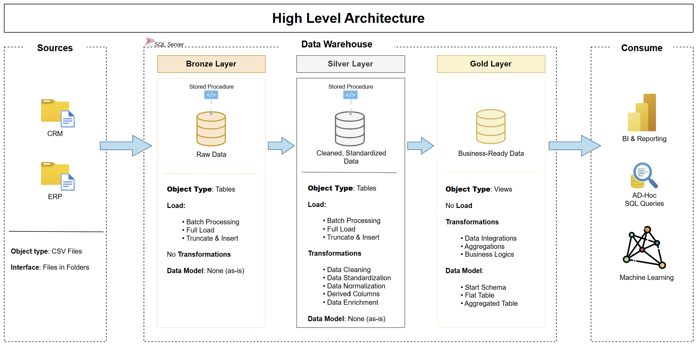

# 🏦 SQL Data Warehouse & Analytics Project

This project demonstrates a complete end-to-end **SQL Data Warehouse** and analytics solution built using the **Medallion Architecture (Bronze, Silver, Gold)**. It consolidates raw operational data into a clean **Star Schema** to support business reporting and decision-making.

**Tech Stack:** SQL Server (T-SQL) | SSMS | Draw.io | Git & GitHub

---

## 📖 Project Overview

This project covers:
1. **Data Architecture:** Designing a Data Warehouse using **Bronze**, **Silver**, and **Gold** layers.
2. **ETL Pipelines:** Extracting, cleansing, transforming, and loading raw data into structured tables.
3. **Data Modeling:** Building fact and dimension tables (`Star Schema`) optimized for analytical queries.
4. **Analytics & Reporting:** Writing SQL queries and views to uncover actionable business insights.

---

## 🏗️ Data Architecture

The warehouse follows a three-layer **Medallion Architecture**:



- **Bronze Layer:** Stores raw data ingested directly from source CSV files without altering source structure.
- **Silver Layer:** Performs data cleansing, standardization, deduplication, null handling, and data type casting.
- **Gold Layer:** Delivers analytics-ready **Fact and Dimension** models (`Star Schema`) for reporting and BI tools.

---

## 🚀 Project Requirements

### 1. Building the Data Warehouse (Data Engineering)
- **Objective:** Consolidate source data into a centralized SQL Server data warehouse to enable reliable reporting and analytical querying.
- **Specifications:**
  - **Data Sources:** Ingest raw data from source CSV files (e.g., CRM & ERP / Core Banking / Sales datasets).
  - **Data Quality:** Resolve missing values, invalid formats, inconsistent labels, and duplicate records before downstream reporting.
  - **Integration:** Combine multiple source entities into a unified analytical model.
  - **Scope:** Load current/latest dataset snapshots (extendable to incremental or SCD Type 2 tracking as needed).
  - **Documentation:** Maintain clear schema notes, naming conventions, and data definitions.

### 2. Analytics & Reporting (Data Analysis)
- **Objective:** Produce SQL-based analytical outputs covering:
  - **Customer / Account Behavior**
  - **Product / Service Performance**
  - **Revenue & Transaction Trends**

For detailed requirements, see [docs/requirements.md](docs/requirements.md).

---

## 📂 Repository Structure

```text
data-warehouse-project/
├── datasets/                       # Raw source CSV files
├── docs/                           # Architecture diagrams, ERD, data catalog & notes
│   ├── data_architecture.drawio
│   ├── data_architecture.png
│   ├── data_models.drawio
│   ├── data_catalog.md
│   └── naming-conventions.md
├── scripts/                        # SQL scripts for ETL and warehouse layers
│   ├── bronze/                     # DDL & raw data load scripts
│   ├── silver/                     # Cleansing & transformation scripts
│   └── gold/                       # Dimension & fact views/tables
├── tests/                          # Data quality & validation queries
├── .gitignore
├── LICENSE
└── README.md
